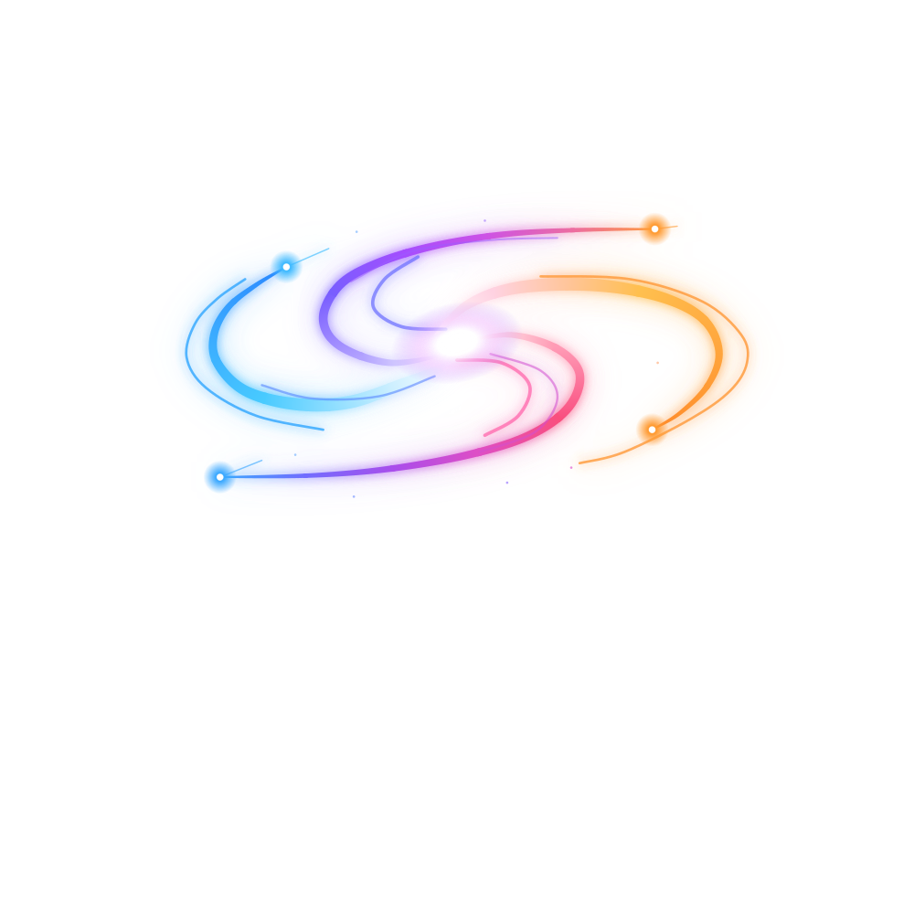
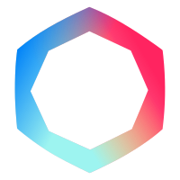

<p align="center"></p>

# StellarEngine

A hypermodular game engine built from the bottom up: a C++ native core, a managed core over it, and everything else as
modules, each in a repository of its own.

```powershell
irm https://quantumdevteam.github.io/StellarEngine-Core/install.ps1 | iex
```

See [Installing](Install.md) for what it needs and what it does. The pages here are the Markdown files of the
repository, so the same text is in the `Docs/` folder; the [API reference](xref:Stellar.Kernel) is generated from
the code of `Stellar.Kernel`, `Stellar.Core`, `Stellar.Runtime` and `Stellar.Tools`.

## Start here

- [Installing](Install.md)

- [README](../README.md)
- [Architecture](Architecture.md)
- [Design Philosophy](DesignPhilosophy.md)

## Architecture

- [Overview](Architecture/Overview.md)
- [Core](Architecture/Core.md)
- [Pipeline](Architecture/Pipeline.md)
- [Repository](Architecture/Repository.md)
- [Modules](Architecture/Modules.md)
- [SDK](Architecture/Sdk.md)
- [Runtime](Architecture/Runtime.md)
- [Tools](Architecture/Tools.md)
- [Native ABI](Architecture/NativeAbi.md)

## Formats

- [Project file](Formats/ProjectFile.md)
- [Module descriptor](Formats/ModuleDescriptor.md)
- [Engine manifest](Formats/EngineManifest.md)
- [Resource container](Formats/ResourceContainer.md)

## Reference

- [SDK properties and items](Reference/Sdk.Properties.md)
- [Diagnostics](Reference/Diagnostics.md)

## Project

- [Contributing](../CONTRIBUTING.md)
- [Git policy](GitPolicy.md)
- [Versioning](Versioning.md)
- [Migrating to 0.8](Migration-0.8.md)
- [License](../LICENSE.md)
- [CLA](../CLA.md)

---

 StellarEngine is made by QuantumDevTeam.
